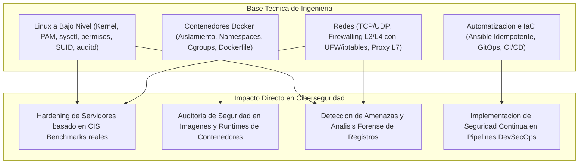

# 01 — Estrategia y Perfil Profesional en Ciberseguridad

[Volver al Índice General](00-indice-general.md) | [Siguiente: Las Tres Vías Profesionales](02-vias-profesionales-ciberseguridad.md)

---

## 1. El Cambio de Paradigma en la Contratación Técnica

En la industria moderna de la seguridad de la información, el valor de los certificados teóricos genéricos de opción múltiple ha sufrido una devaluación sistemática:
* Los reclutadores técnicos y directores de seguridad (CISO, Líderes de SecOps y DevSecOps) descartan currículums que únicamente listan conceptos sin respaldo práctico.
* Cualquier persona puede memorizar definiciones sobre cortafuegos, criptografía o el modelo OSI.
* **Lo que la industria exige:** **Evidencia técnica verificable.** Los equipos buscan ingenieros que demuestren capacidad directa para:
  1. Construir e implementar laboratorios reproducibles con un comando.
  2. Escribir código y scripts de auditoría, hardening o análisis de tráfico.
  3. Redactar reportes técnicos rigurosos que conecten una vulnerabilidad técnica con su impacto y su remediación en código.

---

## 2. La Ventaja Competitiva de la Base Técnica

Muchos aspirantes a ciberseguridad intentan entrar al campo aprendiendo herramientas de ataque superficiales (como suites preinstaladas en distribuciones especializadas) sin entender el funcionamiento del sistema subyacente. 

Un perfil que ya domina **Linux a bajo nivel, contenedores Docker, topología de redes y automatización con Ansible / Infraestructura como Código (IaC)** cuenta con una ventaja estructural inmediata:

1. **Linux es el sustrato de la nube:** La inmensa mayoría de servidores empresariales, clústeres y servicios web corren sobre Linux. Quien entiende la gestión de memoria, procesos, descriptores de archivo y permisos POSIX entiende con naturalidad los vectores de ataque y cómo mitigarlos.
2. **Los contenedores son el estándar de despliegue:** La seguridad moderna ya no se limita al servidor físico; exige asegurar imágenes base, firmas criptográficas de artefactos y políticas de red entre microservicios.
3. **La seguridad que no escala es inútil:** En entornos corporativos de decenas o cientos de servidores, aplicar parches o hardening manual no es viable. La capacidad de automatizar defensas mediante Ansible y pipelines de CI/CD es una habilidad de alta cotización.

---

## 3. Repositorio vs. Plataformas Públicas

Para capitalizar esta ventaja, el profesional dispone de dos frentes complementarios:

| Medio de Validación | Qué Evalúa el Evaluador Técnico | Rol en la Estrategia Profesional |
|---|---|---|
| **Repositorio en GitHub (Código e IaC)** | Capacidad de construcción, calidad de documentación, automatización y criterio de arquitectura segura. | Es la pieza central del portafolio. Demuestra que sabes construir defensas y crear herramientas de auditoría. |
| **Plataformas Oficiales (PortSwigger / HTB)** | Destreza analítica, resolución de problemas bajo condiciones controladas y conocimiento de vulnerabilidades web (OWASP). | Complemento de credibilidad. Acredita que tus habilidades han sido validadas por plataformas estandarizadas del sector. |
