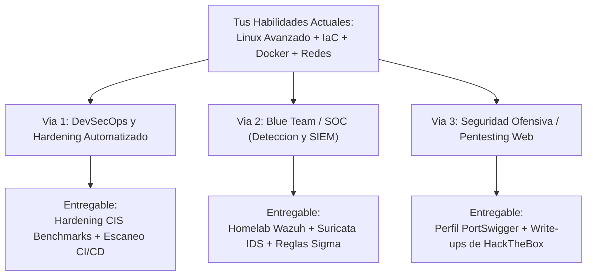

# 02 — Las Tres Vías Profesionales en Ciberseguridad

[Volver al Índice General](00-indice-general.md) | [Anterior: Estrategia y Perfil](01-estrategia-y-perfil-profesional.md) | [Siguiente: Guía de Portafolio](03-guia-portafolio-y-reclutamiento.md)

---

## 1. Mapa de Especializaciones Técnicas

La ciberseguridad contemporánea se divide en disciplinas con metodologías y entregables diferenciados. La siguiente matriz ilustra cómo tu base técnica se proyecta hacia las tres ramas de mayor demanda:

---

## 2. Opción 1: DevSecOps y Hardening Automatizado (Alta Demanda y Rápida Ejecución)

Esta rama traslada las prácticas de seguridad a las fases tempranas del ciclo de vida del software (*Shift-Left Security*). Consiste en asegurar que la infraestructura y los contenedores salgan al entorno de producción con una configuración endurecida por defecto.

### Componentes Clave del Proyecto:
1. **Auditoría Automatizada de Cumplimiento CIS Benchmark:**
   * Script en Bash o playbook de Ansible que audite un servidor Linux contra el estándar oficial **CIS Level 1**.
   * Verificación de parámetros de kernel vía `sysctl` (protección contra IP spoofing, desactivación de redirección ICMP, TCP SYN cookies).
   * Verificación de permisos de archivos de autenticación (`/etc/passwd`, `/etc/shadow`, `/etc/gshadow`).
   * Configuración de montaje seguro de particiones (`nodev`, `nosuid`, `noexec` en `/tmp` y `/var/tmp`).
2. **Pipeline de Seguridad Continua en CI/CD (GitHub Actions):**
   * **Análisis Estático de Seguridad (SAST) con Semgrep:** Detección de inyecciones SQL, vulnerabilidades XSS y cadenas de secretos expuestas directamente en el código fuente.
   * **Análisis de Vulnerabilidades en Imágenes Docker con Trivy o Grype:** Detección automática de dependencias vulnerables y paquetes de sistema con CVEs de severidad Alta o Crítica.
   * **Linting de Dockerfile con Hadolint:** Cumplimiento de buenas prácticas de seguridad (ejecución como usuario no-root, pines de versiones exactos, descarte de herramientas de compilación).

---

## 3. Opción 2: Blue Team y Detección de Amenazas (SOC / Defensiva)

Esta especialización se enfoca en la monitorización de infraestructura, la visibilidad de eventos del sistema operativo, el análisis forense y la creación de reglas de detección de intrusiones en tiempo real.

### Componentes Clave del Proyecto:
1. **Despliegue de un SIEM Open-Source (Wazuh):**
   * Despliegue de un clúster ligero de Wazuh Manager, Indexer y Dashboard mediante Docker Compose.
2. **Instrumentación del Agente de Auditoría:**
   * Instalación del agente de Wazuh en un nodo objetivo instrumentado con `auditd` para capturar llamadas al sistema (*syscalls*), ejecución de comandos privilegiados y modificaciones de archivos sensibles.
3. **Simulación de Ataque Controlado:**
   * Ejecución de pruebas de concepto reproducibles dentro del laboratorio aislado (ejemplo: ataque de fuerza bruta SSH con `hydra` o intento de escalada de privilegios abusando de permisos en `sudoers`).
4. **Respuesta y Traza Forense:**
   * Extracción de las trazas de registro generadas por el incidente.
   * Creación de una regla personalizada de detección (formato XML de Wazuh o estándar Sigma).
   * Documentación del informe técnico del incidente siguiendo el marco MITRE ATT&CK.

---

## 4. Opción 3: Seguridad Ofensiva y Pentesting Web (Red Team)

Se centra en la identificación de fallos de diseño y errores de implementación en aplicaciones web y servicios expuestos mediante técnicas de explotación ética.

### Componentes Clave del Proyecto:
1. **Ruta de Laboratorios en PortSwigger Web Security Academy:**
   * Resolución práctica y documentada de las categorías fundamentales de OWASP Top 10:
     * *SQL Injection (SQLi):* Extracción de datos ciega, basada en uniones y basada en errores.
     * *Cross-Site Scripting (XSS):* Reflejado, almacenado y basado en DOM.
     * *Cross-Site Request Forgery (CSRF):* Bypasses de tokens y políticas de SameSite.
     * *Fallas de Autenticación:* Bypasses de 2FA, ataques de fuerza bruta con encabezados de proxy y lógica de restablecimiento de contraseñas.
2. **Write-ups Técnicos Profesionales (Hack The Box / TryHackMe):**
   * Resolución de 3 a 5 máquinas vulnerables de nivel intermedio.
   * **Estructura obligatoria de auditoría profesional:**
     * *Resumen Ejecutivo:* Impacto de negocio y riesgo evaluado.
     * *Vector de Entrada Inicial (Foothold):* Descubrimiento de servicios y explotación de la vulnerabilidad inicial.
     * *Escalada de Privilegios:* Identificación de mala configuración local (permisos SUID, tareas cron vulnerables o debilidades en el kernel) para alcanzar privilegios de superusuario (`root`).
     * *Mapeo de Vulnerabilidad:* Clasificación formal bajo estándares CWE y CVE.
     * *Recomendación de Mitigación:* Parches exactos de código y configuración para el equipo de desarrollo.
