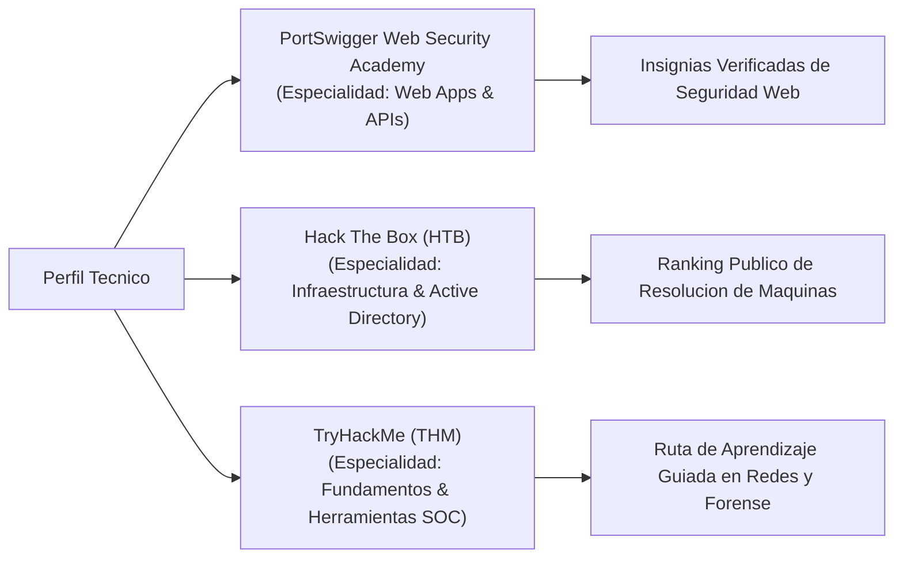

# 04 — Laboratorios y Plataformas Oficiales

[Volver al Índice General](00-indice-general.md) | [Anterior: Guía de Portafolio](03-guia-portafolio-y-reclutamiento.md) | [Siguiente: Hoja de Ruta](05-hoja-de-ruta-y-siguientes-pasos.md)

---

## 1. La Importancia de las Plataformas Prácticas Estandarizadas

Para complementar un portafolio de código en GitHub, la industria reconoce perfiles públicos en plataformas especializadas donde cada ejercicio superado es verificado automáticamente por la infraestructura del proveedor.

Las tres plataformas de referencia internacional son:

---

## 2. PortSwigger Web Security Academy (Referencia en Seguridad Web)

Creada por **PortSwigger** (los desarrolladores de **Burp Suite**, la herramienta de interceptación y auditoría web estándar en la industria). Es **100% gratuita**, con cientos de laboratorios reales diseñados por investigadores de seguridad.

### Rutas Críticas Recomendadas:
1. **Server-Side Vulnerabilities:**
   * *SQL Injection:* Ataques a bases de datos relacionales, extracción de tablas ciega mediante errores y tiempos.
   * *Authentication & Access Control:* Bypasses de autorización horizontal y vertical, debilidades en tokens JWT.
   * *Server-Side Request Forgery (SSRF):* Explotación de llamadas internas hacia servicios de metadatos en la nube (AWS/GCP).
2. **Client-Side Vulnerabilities:**
   * *Cross-Site Scripting (XSS):* Ejecución de scripts en navegadores cliente, robo de cookies de sesión sin flag `HttpOnly`.
   * *Cross-Site Request Forgery (CSRF):* Envío forzado de peticiones autenticadas.
   * *CORS Misconfigurations:* Orígenes no confiables autorizados con credenciales.

### Cómo Exhibir el Progreso:
PortSwigger proporciona una URL pública oficial con el desglose exacto de laboratorios resueltos divididos por nivel (*Apprentice*, *Practitioner*, *Mystery Lab*), que puede ser incorporada en el encabezado de un CV técnico o perfil de LinkedIn.

---

## 3. Hack The Box (HTB) — Auditoría de Infraestructura y Redes

Hack The Box es la plataforma líder para evaluación de habilidades en sistemas operativos, servicios de red y escalada de privilegios.

### Enfoque de Práctica:
* **Máquinas Linux:** Excelente para poner a prueba conocimientos de configuración de servicios (`cron`, `sudoers`, capacidades de Linux `getcap/setcap`, análisis de binarios SUID).
* **Entornos Active Directory:** Simulación de redes corporativas Windows (ataques Kerberos, Kerberoasting, AS-REP Roasting).
* **Metodología:** Cada máquina resuelta se traduce en un **Write-up técnico** que se añade a la carpeta `docs/` de tu portafolio público.

---

## 4. TryHackMe (THM) — Fundamentos y Operaciones Defensivas

TryHackMe ofrece rutas de aprendizaje guiadas (*learning paths*) especialmente útiles para la rama de **Blue Team**:
* *SOC Level 1 / Cyber Defense:* Análisis de capturas de red con Wireshark, parsing de eventos en Splunk y monitoreo con Zeek.
* *Linux Privilege Escalation:* Laboratorios prácticos dedicados exclusivamente a vectores de escalada local en Linux.

---

## 5. Regla de Oro en Plataformas de Seguridad

> [!IMPORTANT]
> Prohibido el uso de tutoriales o soluciones (*spoilers*) para completar laboratorios sin comprensión. El objetivo no es acumular puntos, sino desarrollar el **pensamiento analítico de investigación**:
> * Formular una hipótesis sobre cómo funciona el sistema objetivo.
> * Diseñar una prueba de concepto mínima para confirmar o refutar la hipótesis.
> * Explotar el fallo respetando las restricciones del entorno.
> * Documentar la causa raíz técnica y la remediación.
