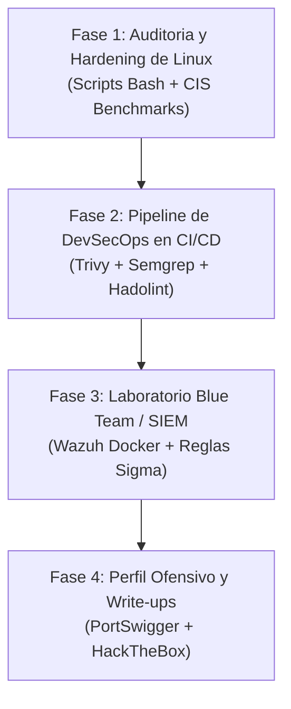

# 05 — Hoja de Ruta Táctica y Siguientes Pasos

[Volver al Índice General](00-indice-general.md) | [Anterior: Laboratorios Oficiales](04-laboratorios-y-plataformas-oficiales.md)

---

## 1. Plan de Ejecución Secuencial

Para construir un portafolio de ciberseguridad sólido y estructurado de forma incremental, este repositorio seguirá una hoja de ruta dividida en cuatro fases técnicas:

---

## 2. Desglose de Fases de Implementación

### Fase 1: Auditoría y Hardening de Linux (Implementada e Incremental)
* **Objetivo:** Disponer de herramientas propias para auditar la seguridad de cualquier servidor Linux de forma inmediata.
* **Entregables:**
  * [`scripts/audit-linux-quick.sh`](../scripts/audit-linux-quick.sh): Script de reconocimiento rápido de puertos, estado de firewall UFW, hardening de OpenSSH, permisos de archivos críticos y binarios SUID.
  * *Próximo paso:* Evolucionar el script hacia un evaluador automatizado de **CIS Benchmark Level 1** para Debian y Ubuntu.

### Fase 2: Pipeline de DevSecOps en CI/CD
* **Objetivo:** Automatizar la inspección de seguridad en cada commit de código e imagen de contenedor.
* **Entregables:**
  * Implementar el workflow `.github/workflows/security-scan.yaml`.
  * Integrar **Trivy** para fallar el pipeline si una imagen Docker contiene CVEs de severidad Crítica no mitigadas.
  * Integrar **Semgrep** con reglas de seguridad OWASP para detectar inyecciones SQL o secretos expuestos.

### Fase 3: Laboratorio Blue Team / SIEM (Wazuh)
* **Objetivo:** Demostrar dominio en monitorización de eventos, auditoría de llamadas al sistema y detección de anomalías.
* **Entregables:**
  * Crear la carpeta `lab-wazuh/` con `docker-compose.yml` para levantar Wazuh Manager, Indexer y Dashboard.
  * Instrumentar un contenedor cliente con `auditd`.
  * Diseñar un script de simulación de intrusión (ataque de fuerza bruta SSH con `hydra` o ejecución de comandos sospechosos en `/tmp`).
  * Documentar la alerta generada en Wazuh y redactar una regla personalizada de detección.

### Fase 4: Especialización Ofensiva y Write-ups Profesionales
* **Objetivo:** Validar la capacidad de auditoría web y red mediante plataformas oficiales.
* **Entregables:**
  * Crear la carpeta `docs/writeups/`.
  * Resolver laboratorios clave de PortSwigger (SQLi, XSS, CSRF) e incorporar el enlace al perfil público en el README.
  * Redactar dos informes técnicos de auditoría de máquinas de Hack The Box con formato formal corporativo.

---

## 3. Estado Actual del Repositorio

* **Fase 1 (Inicial):** Estructura base inicializada, script de auditoría rápida [`scripts/audit-linux-quick.sh`](../scripts/audit-linux-quick.sh) funcional y suite documental Docs-as-Code completada.
* **Fases 2, 3 y 4:** Definidas y listas para ser desarrolladas progresivamente según la especialización deseada.
